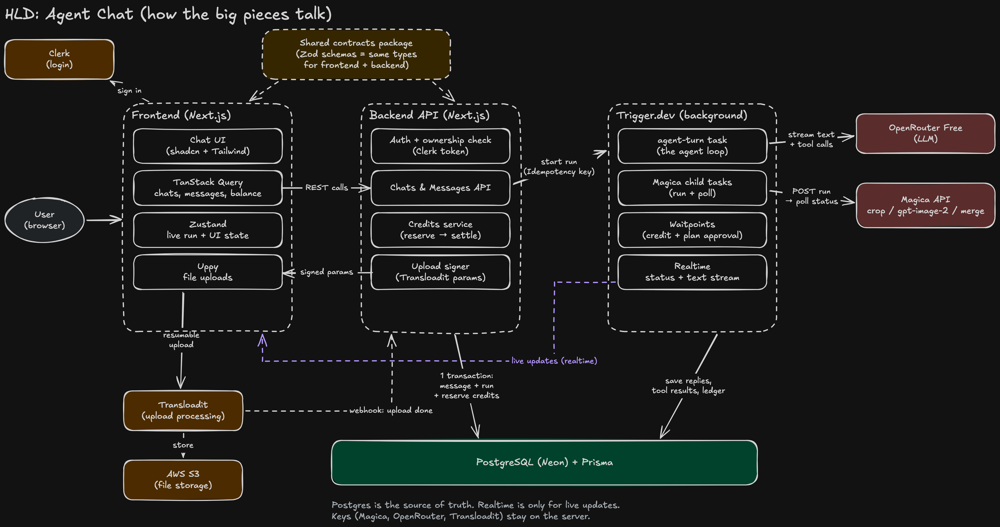
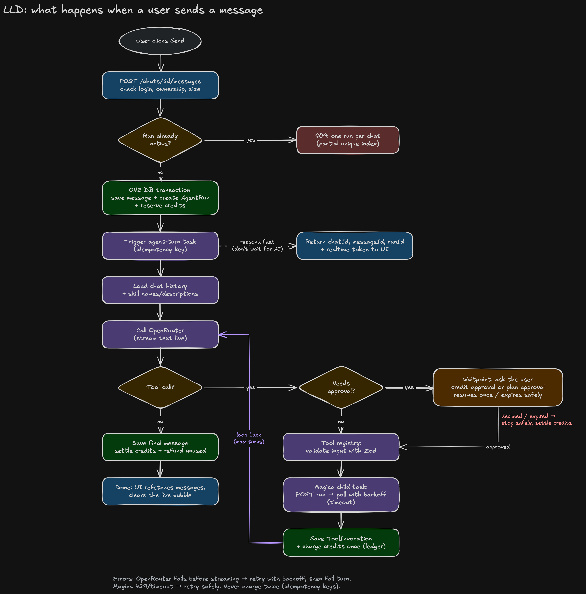
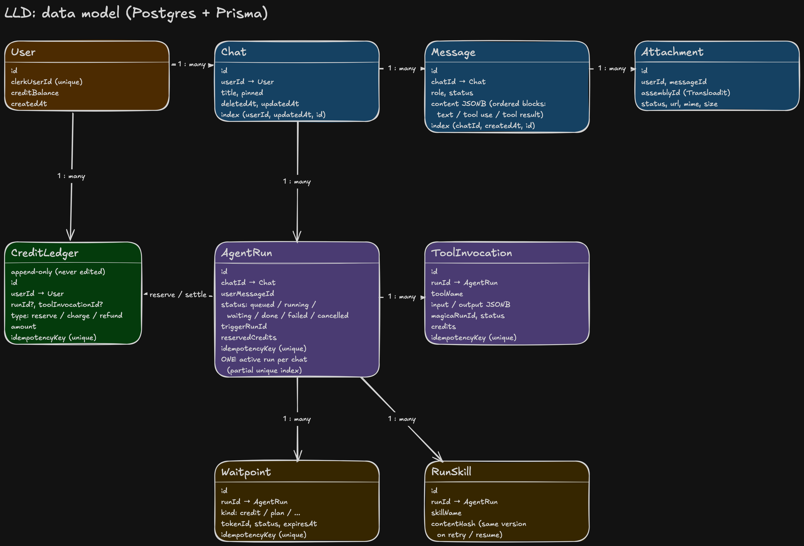

# Agent Chat — Backend

Backend for the Agent Chat clone (Magica / Galaxy work trial). Frontend lives in a separate repo.

In short: the frontend sends a message, this backend saves it, starts a durable background run on **Trigger.dev**, and returns straight away. The agent then works in the background — talks to **OpenRouter Free**, loads **skills** when needed, calls **tools** (Crop Image, GPT Image 2, Merge Videos through the Magica API), asks the user for approval when required, and streams progress live. Everything is saved in **Postgres**, so a page reload or a dropped connection doesn't lose anything.

> **Status:** complete. Everything in the spec is built and tested: the durable agent loop, OpenRouter Free + vision model fallback cascade, skills loader, Magica tools (Crop Image, GPT Image 2, Merge Videos), human approvals/waitpoints, plan mode, streaming reasoning and text, credit ledger (reserve → settle / refund), Transloadit + permanent S3 storage, unified media library, signed webhooks with SSRF protection, Postgres-based rate limits, tool estimate endpoint, model discovery, and run status. All migrations are tracked in [`docs/MIGRATIONS.md`](docs/MIGRATIONS.md).

---

## Tech stack

| Area | What we use |
|---|---|
| Framework | Next.js 16 App Router — **route handlers only**, no UI |
| Language | TypeScript (strict) |
| Database | PostgreSQL on Neon + Prisma 7 (Neon adapter) |
| Auth | Clerk |
| LLM | OpenRouter Free (`openrouter/free` only, no paid fallback) |
| Background jobs + realtime | Trigger.dev v4 |
| Uploads | Transloadit Community + S3 |
| Validation | Zod |
| Tests | Vitest |
| Package manager | pnpm |

---

## Setup

You need Node 22+ and pnpm.

**1. Install**
```bash
pnpm install
```

**2. Env**
```bash
cp .env.example .env
```
Fill every value. The app checks them at startup and tells you exactly which one is missing.

| Key | Where to get it |
|---|---|
| `DATABASE_URL` | Neon → Connect → **pooled** connection string |
| `DIRECT_URL` | Neon → Connect → turn pooling **off** (used only for migrations) |
| `CLERK_SECRET_KEY` | Clerk dashboard → API keys |
| `TRIGGER_SECRET_KEY` | Trigger.dev → project → API keys (dev) |
| `LLM_API_KEY` | openrouter.ai → Keys |
| `LLM_BASE_URL` | `https://openrouter.ai/api/v1` |
| `LLM_MODEL` | must be `openrouter/free` |
| `MAGICA_BASE_URL` / `MAGICA_API_KEY` | supplied for the trial |
| `TRANSLOADIT_KEY` / `TRANSLOADIT_SECRET` | Transloadit → Credentials |
| `TRANSLOADIT_S3_CREDENTIALS` | optional Transloadit S3 credential name for permanent storage (e.g. `magica20`) |
| `CLIENT_ORIGIN` | frontend URL, e.g. `http://localhost:3000` |
| `STARTING_CREDITS` | credits a new user gets, e.g. `100` |
| `MAX_AGENT_TURNS` | safety limit for the agent loop, e.g. `8` |

Also put your Trigger.dev **project ref** (`proj_...`) in `trigger.config.ts`.

**3. Database**
```bash
pnpm db:deploy      # apply migrations
pnpm db:generate    # generate Prisma client
```
See [`docs/MIGRATIONS.md`](docs/MIGRATIONS.md) for full migration history, rollback SQL, and zero-downtime safety notes.

**Test login**
- Live app: https://magica-frontend-six.vercel.app
- A reviewer account (email + password) is shared with the submission, not stored in this public repo. You can also sign in with Google or GitHub.

**4. Run**
```bash
pnpm dev            # API on http://localhost:4000
pnpm trigger:dev    # Trigger.dev worker (second terminal)
```
Check it's alive: `curl http://localhost:4000/api/v1/health` → `{"ok":true}`

**5. Checks**
```bash
pnpm typecheck
pnpm lint
pnpm test
pnpm docs:openapi   # rebuild api-docs/openapi.json
pnpm sync:contracts # sync schemas to client/
```
⚠️ Tests in `tests/db/` write to the database in `DATABASE_URL`. Use a separate Neon branch for testing, not your main one.

---

## Project structure

```
src/
  app/api/v1/     HTTP routes — thin: auth → validate → call module → respond
  contracts/      Zod schemas for every shape (shared with the frontend)
  lib/            db, env, errors, logger
  modules/        business logic, one folder per feature (chats, runs, credits…)
  agent/          agent loop, OpenRouter + Magica clients, tools, skills
  trigger/        Trigger.dev tasks
  proxy.ts        CORS
agent-skills/     skills: agent-skills/<name>/SKILL.md
prisma/           schema + migrations (each migration has NOTES.md with rollback SQL)
tests/db/         tests that need a real database
docs/             architecture and design docs
```

We keep it simple on purpose: no empty placeholder files, no barrel `index.ts` files, a file becomes a folder only when it really grows, and unit tests sit next to the code they test.

---

## Architecture overview



Three ideas drive everything:
1. **The API is quick.** It validates, saves, starts the run, and returns `runId` + a realtime token. It never waits for the AI.
2. **Trigger.dev does the long work.** One durable task per agent turn. Waiting (approvals, Magica polling) doesn't burn compute.
3. **Postgres is the source of truth.** Realtime is only for live UI. After a reload, the frontend reads state from the API and reconnects.

Key subsystems:
- **Uploads & Storage:** Client requests signed Transloadit params, uploads files directly, and backend stores them permanently in S3 using Transloadit S3 Template Credentials (with 24h temporary fallback when unconfigured). Files are tracked as attachments and exposed via the unified Media Library.
- **Webhooks:** Optional webhooks for tool runs and agent runs with Stripe-style HMAC-SHA256 signatures (`X-Webhook-Signature: t=...,v1=...`), delivered asynchronously via Trigger.dev tasks with bounded retries, exponential backoff, and delivery-time DNS SSRF protection.
- **Vision Model Fallback:** Free OpenRouter model routing automatically detects image attachments and routes requests through configured free vision models (`VISION_MODELS`) to avoid hallucinations.
- **Rate Limits & Protection:** 20 messages/min and 10 tool runs/min per user, tracked in Postgres with composite indexes. Over limit returns 429 with computed `retryAfterSeconds` and `Retry-After` header.
- **Credit Engine:** Append-only ledger tracks every reserve, charge, settle, and refund. Tools estimate live Magica pricing before reserving.

**What happens when a user sends a message:**



**Data model** (target design — tables are added step by step, `prisma/schema.prisma` shows what exists today):



More detail:
- [`docs/ARCHITECTURE.md`](docs/ARCHITECTURE.md) — big picture, request flow, scaling

---

## Design decisions and trade-offs

Only decisions that are already in the code. This table grows as features are built — the full plan with reasons is in [`docs/DECISIONS.md`](docs/DECISIONS.md).

| Decision | Why | Trade-off |
|---|---|---|
| Backend is a separate Next.js app with only route handlers | Trial needs two repos + REST via Next.js route handlers (confirmed on Slack) | Two deploys, CORS between them |
| One active run per chat enforced by a **partial unique index** in Postgres | The DB guarantees it even with two tabs or two servers. App-level checks can race. | Raw SQL in the migration that Prisma doesn't know about — a test protects it |
| Foreign keys with `ON DELETE RESTRICT`, soft delete planned via `deletedAt` | Nothing gets deleted by accident; history like runs is never lost | Delete logic (coming with chat management) must filter `deletedAt: null` |
| Merged keyset cursor pagination for Media Library | Merges tool outputs (`ToolInvocation`) and user uploads (`Attachment`) by `(createdAt desc, id desc)` without duplicate entries from library reuses. | Merging two sorted streams in memory requires reading `limit + 1` from both tables per page |
| Vision model fallback cascade for free tier | `openrouter/free` routes to text models that hallucinate when given images. We cascade through free vision models (`VISION_MODELS`) and reject any paid model at startup. | Sequential fallback can add 2–3s if the primary free vision model is busy |
| Durable waitpoints via Trigger.dev tokens | Human approvals (options, plan review, credits) pause the agent turn with zero compute burn. Resuming is idempotent and picks up right where it stopped. | Active runs remain in Postgres status `waiting` until the user responds or the 24h timeout expires |
| Append-only credit ledger (reserve → settle / refund) | Every single credit movement is traceable like a bank statement with its own idempotency key. Failed/cancelled runs refund cleanly. | Requires dual-write in transactions (user balance update + ledger entry) |
| Search with Postgres `pg_trgm` GIN indexes | Fast substring and fuzzy search for chat titles and message text directly in Postgres with no extra service (like Elasticsearch or Algolia). | Trigram index updates add slight write overhead on long messages |

---
## What I'd improve with more time

- **Favorites and folders:** let users favorite chats and media and organize them into folders. The Favorites tab and "My folders" are in the UI but not wired up yet.
- **MCP server:** expose the agent and the three Magica tools as an MCP server, so tools like Claude Desktop or Cursor can start chats and run tools through the same API, credits and auth.
- **SSH chat client:** chat with the agent from a terminal over SSH (`ssh chat.<domain>`), streaming replies and tool progress live, built on the public API and the same realtime streams as the web app.
- **Chat-style completions endpoint:** an OpenAI-compatible `/v1/chat/completions` route on top of agent runs, the one bonus API route not built yet.
- **Smarter free-model routing:** track which free vision models are up and send image turns to a healthy one first, instead of trying them in a fixed order.
- **Load testing at scale:** benchmark 1,000 concurrent agent turns (database connections, Trigger.dev queues, realtime fan-out) and tune limits from the results.